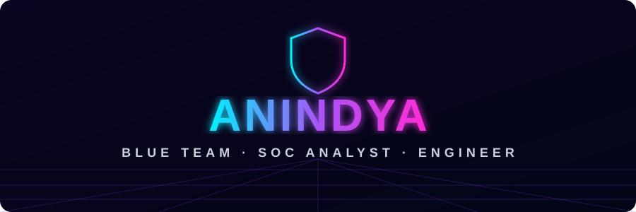

<div align="center">




<br/>

<a href="https://www.linkedin.com/in/anindya-chakraborty-9736a2447/"></a>
<a href="mailto:anindyac708@gmail.com"></a>
<a href="https://github.com/Anindya8055/soc-investigations"></a>


</div>


## ⚡ `> whoami`

<table><tr><td>

**Anindya Chakraborty**, a software engineer turned **Blue Teamer** from Dhaka, Bangladesh 🇧🇩

- 💼 **Junior Software Engineer** @ Savvy Techmart: I build and secure live web tools
- 🛡️ **Training for SOC Analyst**: I hunt malware in real traffic captures and SIEM logs
- 🎓 **B.Sc. CSE**, AIUB (2026), CGPA 3.62
- 🧪 **Home lab:** Arch Linux, isolated low-privilege analysis account, malware **never executed**
- 🧭 **Rule I work by:** *tag only what the evidence supports*

</td></tr></table>


## 🔎 `> cat cases/`

<div align="center">

| 🗂️ CASE | ☣️ THREAT | 🎯 WHAT I PROVED | 🧰 TOOLS |
|:--|:--|:--|:--|
| **[Easy As 123](https://github.com/Anindya8055/soc-investigations)** | NetSupport RAT | C2 beaconing → host, user & full name via DHCP · Kerberos · SAMR | Wireshark |
| **[SSH Dictionary Attack](https://github.com/Anindya8055/soc-investigations)** | Brute force | 948 failed logins from one IP, zero successes, mapped to **T1110** | Splunk SPL |
| **[Natureforce](https://github.com/Anindya8055/soc-investigations)** | CNCmachineRMS RAT | Malware over port 9000 → SHA-256 → VirusTotal confirmed | Wireshark · tshark |
| **[Kongtuke Rebuke](https://github.com/Anindya8055/soc-investigations)** | ClickFix | No IOC given, hunted it down through DNS & TLS SNI | Wireshark |

<a href="https://github.com/Anindya8055/soc-investigations"></a>

`NEXT UP ▸ FormBook · Lumma Stealer · "It's a Trap!"`

</div>


## 🧰 `> ls arsenal/`

<div align="center">

**🛡️ DEFEND**<br/>


**⚙️ BUILD**<br/>


</div>


## 🛠️ `> ls builds/`

<div align="center">

| 🚀 PROJECT | 💡 WHAT IT DOES | 🧱 STACK |
|:--|:--|:--|
| **[Huntbox](https://github.com/Anindya8055/Huntbox)** | Pulls Product Hunt launches, ranks them, and adds company domains & public contacts | FastAPI · GraphQL · SQLite |
| **[LeadMap](https://github.com/Anindya8055/Google-Maps-Scraper-)** | Google Maps lead finder with website checks (SSL, domain age) and 0–100 scoring | Next.js · Prisma · SQLite |
| **[Face Shape Detector](https://github.com/Anindya8055/Ai-Face-Shape-Detector)** | Computer-vision prototype with an honest accuracy write-up | FastAPI · MediaPipe · scikit-learn |

`+ 5 live web tools & a client inventory system built at work (private by company policy)`

</div>


## 📡 `> status --now`

```diff
+ [ACTIVE] More malware-traffic write-ups
+ [ACTIVE] Deeper Splunk: eval, transaction
+ [ACTIVE] Preparing for ISC2 CC
! [OPEN]   Entry-level SOC roles
! [OPEN]   Remote · night & APAC shifts
```

<div align="center">


<sub>⚽ Off the keyboard: football (playing & watching) · movies & series</sub>

</div>
